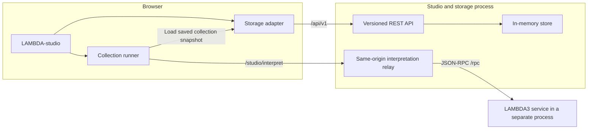

# Assignment 09 · LAMBDA-studio

LAMBDA-studio saves named LAMBDA programs and ordered test collections through
a local REST API. Saved data survives browser reloads and is cleared when the
storage process stops. The separate LAMBDA3 service interprets saved cases when
the user runs a collection.

## Setup

Use Python 3.12 or later. The runtime uses Flask 3.1 and the browser tests use
Playwright 1.65.2. Keep the virtual environment outside the submission folder.
Run the commands from `assigns/09/MySolution/` or a standalone copy of that
directory.

macOS or Linux

```sh
assign09_env="$(mktemp -d)"
python3 -m venv "$assign09_env"
source "$assign09_env/bin/activate"
python -m pip install -r requirements-dev.txt
```

Windows PowerShell

```powershell
$assign09Env = Join-Path ([System.IO.Path]::GetTempPath()) 'cs413-assign09-venv'
py -3 -m venv $assign09Env
& (Join-Path $assign09Env 'Scripts/Activate.ps1')
python -m pip install -r requirements-dev.txt
```

For runtime only, install `requirements.txt`. For the browser tests, either
install Chromium with `python -m playwright install chromium` or use a local
Chrome installation as described below.

## Start the studio and LAMBDA3

Activate the same environment in both terminals and run both commands from
`MySolution/`. Run one process per service to keep a single in-memory store.

In terminal 1, start the packaged Assign07 LAMBDA3 service.

```sh
python -B -m flask --app runtime.assign07.MySolution.lambda_rpc.http:create_app run --host 127.0.0.1 --port 8000
```

In terminal 2, start the studio and storage API.

```sh
python -B -m flask --app studio_storage.studio:create_app run --host 127.0.0.1 --port 8001
```

Open [LAMBDA-studio](http://127.0.0.1:8001/). The storage API base URL is
`http://127.0.0.1:8001/api/v1`, and LAMBDA3 accepts JSON-RPC requests at
`http://127.0.0.1:8000/rpc`. Stop each service with Ctrl+C.

To serve the storage API by itself, use the storage app factory in place of the
studio app factory.

```sh
python -B -m flask --app studio_storage.http:create_app run --host 127.0.0.1 --port 8001
```

## Try it

1. In **Programs**, save a program named `Product` with source `6 * 7`. Reload
   the page and select **Product** to reopen it.
2. In **Test collections**, create `Arithmetic` and add the following cases.

   | Case | LAMBDA source | Expected outcome |
   | --- | --- | --- |
   | Product | `6 * 7` | Formatted value `42` |
   | Incomplete conditional | `if then` | Syntax error |
   | Invalid addition | `1 + true` | Type error |

3. Click **Run collection**. The summary should show `3 passed, 0 failed.`
   Expand a result to see the expectation, observed outcome, and source used.
4. Open the same program in two tabs. Save an edit in one tab, then try to save
   an edit in the other. The stale tab keeps its draft and offers
   **Reload server copy**.

For a quick API check from a POSIX shell, run the following commands.

```sh
curl -fsS http://127.0.0.1:8001/api/v1/health
curl -i -H 'Content-Type: application/json' \
  -d '{"name":"Product example","source":"6 * 7"}' \
  http://127.0.0.1:8001/api/v1/programs
```

The create response includes the saved program and `ETag: "1"`. See the
[API contract](API.md) for conditional writes, cursor usage, and error
examples and the [OpenAPI description](openapi.json) for machine-readable
schemas.

## Limits

| Limit | Value |
| --- | --- |
| Source size | 16,384 UTF-8 bytes per program or case |
| Description length | 2,048 Unicode characters |
| HTTP request body | 262,144 bytes |
| Page size | 1–50 records, default 50 |
| Cases per collection | 50 |
| Total live records | 500, counting programs, collections, and cases |

Cursor chains retain their captured representations until the storage process
stops. The packaged LAMBDA3 service gives each interpretation two seconds.

## Tests

The suites create their own applications. The browser suite starts temporary
loopback services and runs the real packaged LAMBDA3 runtime.

```sh
python -B -m unittest discover -s tests -v
python -B -m unittest discover -s tests/browser -v
```

To use installed Chrome, set `ASSIGN09_BROWSER_CHANNEL=chrome` before running
the browser command. In PowerShell, set it with
`$env:ASSIGN09_BROWSER_CHANNEL = 'chrome'`. See [TESTING.md](TESTING.md) for
verified versions, observed results, and test coverage.

## Architecture



The storage service checks revisions and commits each mutation under one
lock. Lists return immutable snapshot pages. The collection runner reads one
saved collection revision per run and compares each LAMBDA3 reply with the
expectation from that revision.
